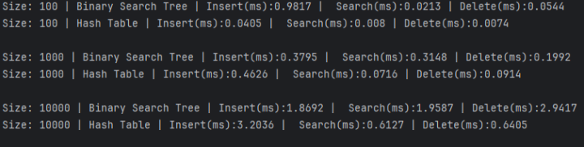

# DAA-bonus_task

## Report

### Theoretical complexity

#### BST
Every method(insertion, search and deletion) has time complexity: O(n), Theta(logn) and
Omega(1). Mechanism of BST: for each node, smaller values move to left subtree, bigger to
right subtree. In worst case tree degenerates to linked list and in best cases is when target
element is in root node

* Insertion: Compares the new value with the current node. If it is smaller, it moves to the left subtree, 
if it is larger, it moves to the right. When it finds an empty spot, it places the new node there.
* Search: Checks the current node. If the value matches, the search ends. If the target is smaller, it moves left, 
if larger, it moves right. If it hits an empty spot, the element does not exist in the tree.
* Deletion: First finds the node. If the node has no children, it simply removes it. If it has one child, it replaces 
node with that child. If it has two children, it finds the smallest value in the right branch (in-order successor), 
replaces the node's value with it, and deletes the duplicate below.

#### Hash Table
Every method(insertion, deletion and search) has time complexity: O(n), Theta(logn) and
Omega(1). Mechanism of Hash Table: for every key creates hash code(bucket index) from
hash function. Collision solved by linked lists. When load factor is bigger than 0,75, the
table doubles its capacity and rehashes existing items. In best case, direct array indexing
allows near-instant access with minimal chain traversal and worst case when every key
located in same bucket or when insertion triggers resize and rehash

* Insertion: Passes the key through a hash function to calculate its bucket index in the array. It checks the bucket's linked list 
for duplicates and adds the new node to the front. If the table gets too full, it doubles the array size and rehashes all elements.
* Search: Hashes the key to jump directly to the correct bucket, then scans that bucket's short linked list to find the matching key.
* Deletion: Calculates the bucket index using the hash function, locates the node in the chain, and unlinks 
it by pointing the previous node directly to the next node.

### Result

### Performance analyze
Result confirms the theoretical complexity: Search and deletion in hash table much faster
than in BST because of effective addressing O(1) compared to sequential traversals of the
tree in O(log n). Insertion BST at n=10000 shows better performance than Hash Table. It
explained that table often resized and rehashed every existing element. Except insertion
BST at n=100. It 2 times slower then at n=1000, reason is the JVM warm-up effect (JIT
compilation) and structure initialization

### Conclusion
A hash table is significantly more efficient than BST for read and delete operations, thanks
to direct access via hashing. However, insertion of a large volume of data into a hash table
may be slower than in a tree due to dynamically resizing the array